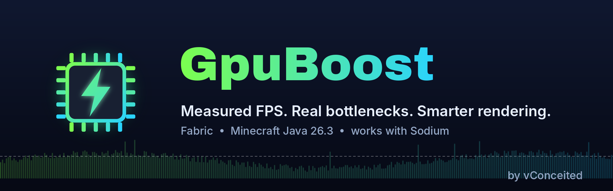

<p align="center"></p>

# GpuBoost

**Fabric mod for Minecraft Java Edition 26.3 by vConceited.**
It measures where each frame's time goes, works out whether the CPU, the GPU, memory or a frame cap is the limit, and cuts work only where cutting helps. It runs alongside Sodium and doesn't replace its renderer.

## Features

| Area | What it does |
|---|---|
| **Bottleneck detector** | Classifies every second as CPU (render thread), CPU (system saturated), GPU, memory/GC, FPS cap or balanced. It uses OpenGL timestamp queries, driver telemetry, render-thread CPU time, system load and GC time. |
| **Adaptive engine** | Three pressure levels with hysteresis, a dead band and cooldowns. When FPS stays below your target it shrinks the entity render distance and lowers particles. It puts them back when FPS recovers, so settings don't flicker. |
| **Entity distance culling** | Skips rendering entities beyond an adaptive distance, before the frustum test. Players, named, glowing and boss-type entities are exempt. Only rendering is affected; gameplay is unchanged. |
| **Weak CPU Mode** | Uses a more aggressive entity budget, slower monitoring and no background telemetry process. It also applies cheaper chunk-meshing settings (biome blend) and turns off entity shadows. |
| **Profiles** | MAX FPS, GPU POWER, WEAK CPU, BALANCED and CUSTOM. Every vanilla setting a profile changes is snapshotted and can be restored. |
| **GPU detection** | GPU model, vendor, driver and backend (OpenGL or Vulkan), plus a capability report covering multi-draw indirect, mesh shaders, persistent buffers and so on. Each entry says honestly who actually uses the feature. |
| **Live UI** | FPS, 1% and 0.1% lows, frame-time graph, CPU and GPU load, VRAM, RAM/GC, entity and chunk statistics, plus recommendations. There is also a compact HUD overlay. |
| **Benchmark** | Repeatable runs (warm-up, then a fixed spin or static camera), a "baseline" mode with every GpuBoost optimization off, and CSV/JSON output with an in-game comparison. |
| **Config** | JSON config with validation, export/import and crash-safe restore of temporary changes. |

Open the menu with **U** (rebindable) or `/gpuboost`.

## Commands (client-side)

```
/gpuboost                                   open the menu
/gpuboost status                            live metrics + bottleneck verdict
/gpuboost profile <max_fps|gpu_power|weak_cpu|balanced|custom>
/gpuboost hud                               toggle the overlay
/gpuboost bench start [seconds] [label]     benchmark with GpuBoost active
/gpuboost bench baseline [seconds] [label]  same, with all GpuBoost optimizations off
/gpuboost bench stop | compare
/gpuboost config export | import [file]
/gpuboost restore                           restore every video setting GpuBoost changed
```

## Building

Requires **JDK 25**. Then, on Windows:

```
gradlew.bat build
```

On Linux/macOS, use `./gradlew build`. The mod jar ends up in `build/libs/gpuboost-1.0.0+mc26.3.jar`. See [docs/BUILD.md](docs/BUILD.md).

## What GpuBoost does not do

GpuBoost doesn't claim to make rendering "GPU-driven". In 26.3, terrain drawing (multi-draw / indirect draws, persistent buffers, section occlusion culling) is done by Sodium or by vanilla. GpuBoost detects and reports those capabilities and leaves them alone. It never overclocks, changes driver or OS power settings, fakes FPS counters or inflates GPU usage. The full spec-to-implementation matrix is in [docs/FEATURES.md](docs/FEATURES.md).

## Documentation

- [Architecture and 26.3 analysis](docs/ARCHITECTURE.md)
- [Feature matrix](docs/FEATURES.md)
- [Install](docs/INSTALL.md) · [Build](docs/BUILD.md) · [Compatibility](docs/COMPATIBILITY.md) · [Benchmarking](docs/BENCHMARKING.md)
- [Project page description](docs/MODRINTH_DESCRIPTION.md)

License: MIT. © 2026 vConceited.
